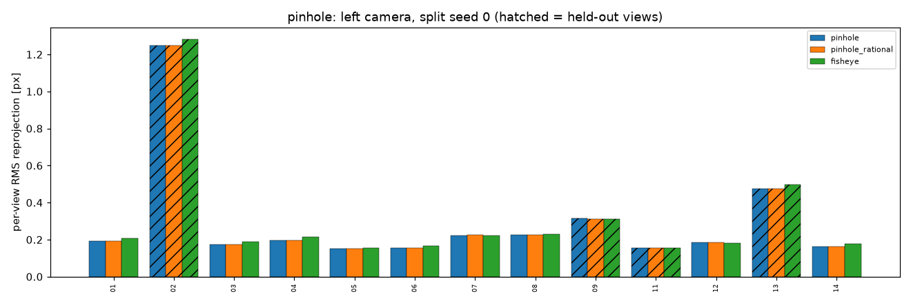
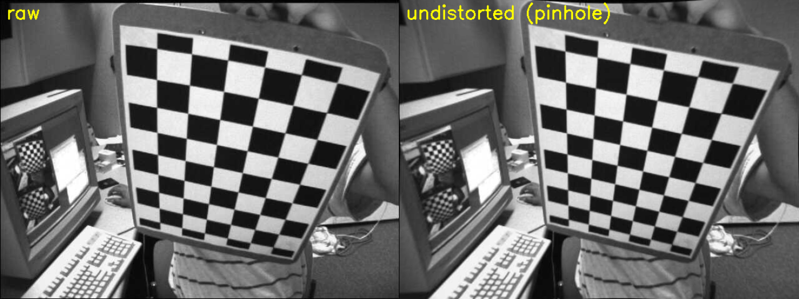
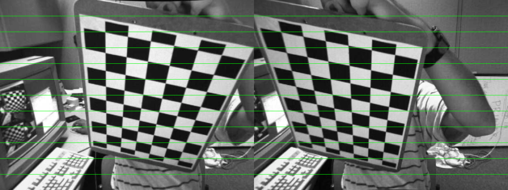
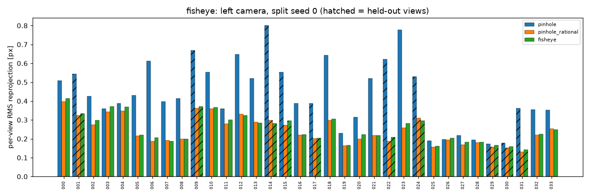
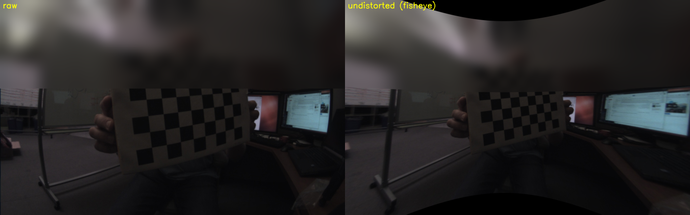
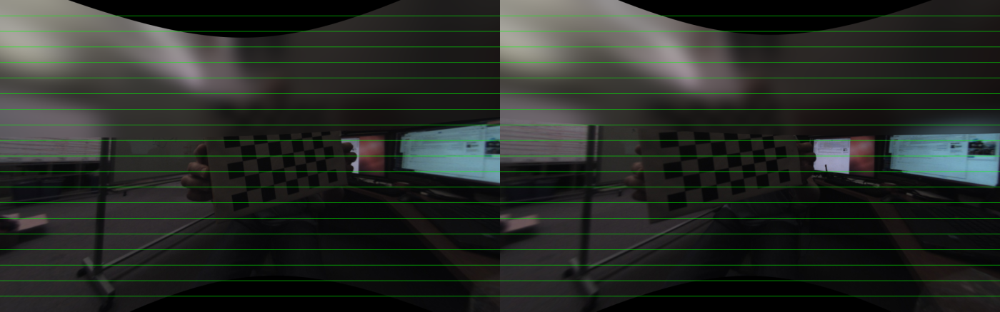

# camera-calibration-report

Pinhole, fisheye and stereo camera calibration with OpenCV, scored on **held-out** views: calibrate on ~70% of the images, then measure error on the ~30% the optimiser never saw.

Author: Ha Phan Thanh Hai. License: MIT (code). Scope: this is a small demo on public sample data, not a claim about any specific rig.

## What the numbers mean
- **Train RMS**: reprojection error on the images used to fit the model. Always optimistic, since the model has been tuned to them.
- **Held-out RMS**: for each unseen view, the board pose is estimated from that view's corners with the intrinsics fixed, then corners are reprojected. This is the honest number. It is usually higher than train RMS. The "same PnP" train column uses the identical procedure, so train and held-out are compared like for like.
- **Epipolar error (stereo)**: after rectification, matching corners should sit on the same image row. Mean abs(dy) in pixels on held-out pairs.
- Besides split 0, every metric is repeated over 20 random 70/30 splits (mean ± std, worst case). With 13 pinhole images a single split is noisy; the spread is the point.

## Data (public, not committed; `python fetch_data.py` downloads it, ~11 MB)
- **Pinhole stereo**: `left01..14/right01..14.jpg` (no 10) from [opencv/opencv `samples/data`](https://github.com/opencv/opencv/tree/4.x/samples/data), Apache-2.0. 9x6 inner corners. The square size is not stated with the images; I assume 25 mm, so baseline in mm scales with that assumption.
- **Fisheye stereo**: 34 pairs, `testdata/cv/cameracalibration/fisheye/calib-3_stereo_from_JY` in [opencv/opencv_extra](https://github.com/opencv/opencv_extra) (1280x800). 8x6 inner corners, 24.4 mm squares (from the set's `object.xml`). opencv_extra has no separate LICENSE file; I treat it as under the OpenCV project's Apache-2.0 license, which is my reading, not a legal opinion. The images show a bystander, so in the committed figures the top 330 rows are blurred; calibration itself uses the unblurred images.

## Results (generated by `report.py` from `results/*.json`)
<!-- RESULTS -->

### Dataset: pinhole (pattern (9, 6) inner corners)

##### Single camera
9 train / 4 held-out views per camera (split 0); 13/13 left views detected

| camera | model | train RMS (OpenCV) | train RMS (same PnP as held-out) | held-out RMS, split 0 | held-out RMS, 20 splits mean ± std (max) | failed splits |
|---|---|---|---|---|---|---|
| left | pinhole | 0.187 | 0.187 | 0.691 | 0.442 ± 0.199 (0.695) | 0/20 |
| left | pinhole_rational | 0.187 | 0.187 | 0.690 | 0.443 ± 0.201 (0.695) | 0/20 |
| left | fisheye | 0.195 | 0.195 | 0.709 | 0.453 ± 0.201 (0.709) | 0/20 |
| right | pinhole | 0.314 | 0.314 | 0.685 | 0.488 ± 0.183 (0.736) | 0/20 |
| right | pinhole_rational | 0.313 | 0.313 | 0.685 | 0.491 ± 0.180 (0.737) | 0/20 |
| right | fisheye | 0.315 | 0.316 | 0.689 | 0.483 ± 0.187 (0.739) | 0/20 |

##### Stereo
13/13 pairs detected in both cameras; 9 train / 4 held-out pairs (split 0); model: pinhole; failed splits 0/20

| quantity | split 0 | 20 splits mean ± std |
|---|---|---|
| baseline [mm] (squares assumed 25.0 mm) | 83.65 | 83.64 ± 0.16 |
| rotation between cameras [deg] | 0.27 | |
| stereoCalibrate RMS (train pairs) [px] | 0.290 | 0.407 ± 0.102 |
| epipolar abs(dy) mean, train pairs [px] | 0.163 | 0.147 ± 0.013 |
| epipolar abs(dy) mean, held-out pairs [px] | 0.135 | 0.154 ± 0.022 |
| epipolar abs(dy) RMS, held-out pairs [px] | 0.274 | 0.270 ± 0.092 |
| epipolar abs(dy) 95th pct / max, held-out [px] | 0.487 / 2.533 | |





### Dataset: fisheye (pattern (8, 6) inner corners)

##### Single camera
24 train / 10 held-out views per camera (split 0); 34/34 left views detected

| camera | model | train RMS (OpenCV) | train RMS (same PnP as held-out) | held-out RMS, split 0 | held-out RMS, 20 splits mean ± std (max) | failed splits |
|---|---|---|---|---|---|---|
| left | pinhole | 0.444 | 0.444 | 0.520 | 0.525 ± 0.115 (0.840) | 0/20 |
| left | pinhole_rational | 0.257 | 0.257 | 0.252 | 0.266 ± 0.023 (0.310) | 0/20 |
| left | fisheye | 0.265 | 0.266 | 0.257 | 0.274 ± 0.023 (0.319) | 0/20 |
| right | pinhole | 0.497 | 0.497 | 0.475 | 0.808 ± 0.847 (3.387) | 0/20 |
| right | pinhole_rational | 0.281 | 0.281 | 0.263 | 0.378 ± 0.209 (1.079) | 0/20 |
| right | fisheye | 0.281 | 0.283 | 0.270 | 0.288 ± 0.026 (0.349) | 0/20 |

##### Stereo
34/34 pairs detected in both cameras; 24 train / 10 held-out pairs (split 0); model: fisheye; failed splits 0/20

| quantity | split 0 | 20 splits mean ± std |
|---|---|---|
| baseline [mm] (squares assumed 24.4 mm) | 99.32 | 99.31 ± 0.12 |
| rotation between cameras [deg] | 4.08 | |
| stereoCalibrate RMS (train pairs) [px] | 0.379 | 0.387 ± 0.013 |
| epipolar abs(dy) mean, train pairs [px] | 0.228 | 0.238 ± 0.019 |
| epipolar abs(dy) mean, held-out pairs [px] | 0.329 | 0.256 ± 0.054 |
| epipolar abs(dy) RMS, held-out pairs [px] | 0.438 | 0.341 ± 0.076 |
| epipolar abs(dy) 95th pct / max, held-out [px] | 0.942 / 1.286 | |





<!-- /RESULTS -->

## Findings and failures (written after reading the tables above)
- **Pinhole set is tiny (13 views, 9 for training).** Held-out error (0.44 px mean over splits) is clearly above train error (0.19 / 0.31 px) and varies a lot between splits (std 0.20). Split 0 happens to be one of the worst splits, so the headline split-0 numbers are pessimistic. The three models are indistinguishable here.
- **Fisheye set: the default 5-coefficient pinhole model is the loser** (right camera: 0.81 ± 0.85 px held-out, worst split 3.4 px). The rational pinhole model and the fisheye model are close (0.27 vs 0.27 px on the left camera). I could **not** show the fisheye model beating the rational pinhole model on accuracy; its visible advantage is stability on the right camera (std 0.03 vs 0.21 px). The board never reaches the extreme image edge, so extrapolation to the edge of the field is untested.
- **Stereo:** baselines are consistent across splits (pinhole 83.6 ± 0.2 mm, fisheye 99.3 ± 0.1 mm), and held-out epipolar error is sub-pixel on average in both. There is **no ground-truth baseline**, so this shows repeatability, not absolute accuracy. The pinhole baseline additionally assumes 25 mm squares. One pinhole pair has a 2.5 px outlier corner row error; I did not investigate its cause.
- **Not covered:** more than two cameras, temperature or sync effects, and any rig other than these two public sets. For the 8x6 board (ambiguous under 180 degree rotation) the code flips the right corners when that lowers the row mismatch; it was never triggered on this data.
- Runtime on one CPU thread (machine was busy with other jobs): `calibrate_mono.py` 23.7 s, `calibrate_stereo.py` 6.7 s, `report.py` a few seconds, `fetch_data.py` ~51 s.

## Reproduce
```
pip install opencv-python numpy matplotlib pytest
python fetch_data.py
python calibrate_mono.py
python calibrate_stereo.py
python report.py        # writes results/report.md and refreshes the block above
pytest -q               # synthetic smoke test, no download needed
```
Versions used: OpenCV 4.13.0, NumPy 2.5.0, Matplotlib 3.11.0, Python 3.12.

## Checklist I use for real rigs (practice, not measured here)
- Target: rigid and flat (aluminium or glass-backed, not paper on a clipboard); size so the board fills roughly a third to a half of the frame at working distance; know the true square size to the 0.1 mm.
- Coverage: 20-40 views; tilt the board up to about 45 degrees; reach all corners and edges of the image, which matters most for fisheye; include a few near and far.
- Exposure: no motion blur (short exposure, hold still), no saturated white squares, even lighting without glare.
- Sync: for stereo or multi-camera, hardware trigger or at least hold the board still; check timestamps and drop pairs with visible skew.
- Temperature: let the camera warm up before capturing; focus and zoom locked; recalibrate if the lens is refocused or the rig is mechanically stressed.
- Always keep a held-out set and look at per-view errors, not only the mean.
